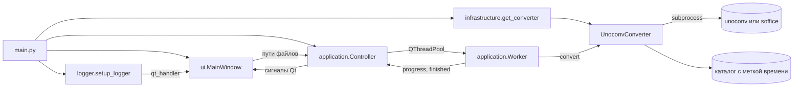

# ConvertorPDF (FileFlow Converter) — документация

Настольное приложение на Python и PyQt6, которое пакетно переводит офисные
документы в PDF. Файлы выбираются в диалоге или перетаскиваются в окно; каждый
файл, кроме PDF, отдаётся LibreOffice (`unoconv` или `soffice --headless`), PDF
копируются без конвертации, результаты складываются в новый каталог с меткой
времени (`application.py:55-65`, `infrastructure.py:12-47`). Окно называется
«FileFlow Converter» (`ui.py:21`). Кто пользователи приложения, в репозитории не
сказано.

Спецификация требований, восстановленная по коду: [`SPEC.md`](../SPEC.md).

## 1. Состояние

| Пункт | Состояние | Источник |
| --- | --- | --- |
| Код приложения (`main.py`, `domain.py`, `application.py`, `infrastructure.py`, `ui.py`, `logger.py`) | последний коммит `fa245a3` «v1.0.0», 2025-09-06 | `git log` |
| Тесты | 4 теста pytest в `test_application.py`, только для `application.py`; последний коммит `6aae78b`, 2026-08-07 | `test_application.py`, `git log` |
| CI | GitHub Actions: `pytest -q` на `windows-latest`, Python 3.13, на каждый push и pull request; прогон 31205491406 на `2ba4388` (2026-08-07) — success, логи прогона уже недоступны (HTTP 410) | `.github/workflows/python-ci.yml`, `gh run view 31205491406` |
| Документированный коммит | `2ba4388`, 2026-08-07, добавлен `scripts/check_before_push.py` | `git log -1` |

Что явно не доделано:

- README обещает конвертер через Microsoft Office на Windows (`OfficeConverter`,
  COM) и выбор конвертера по ОС. В коде такого класса нет (`git log -S
  OfficeConverter` находит только `fa245a3`, где слово есть лишь в README);
  `get_converter()` всегда возвращает `UnoconvConverter` (`infrastructure.py:50-53`).
- `config/settings.yaml` не читает ни один модуль; `PyYAML` и `pywin32-ctypes`
  из `requirements.txt` не импортируются.
- Поле `Document.status` (`domain.py:8`) никогда не меняется; результат
  `convert()` воркер не использует (`application.py:25`).
- Сборка исполняемого файла: закоммичен `main.dist/main.dll` (PE32+ DLL, x86-64,
  9 124 352 байта), `.gitignore` перечисляет `main.build`, `main.dist`,
  `main.onefile-build`, `FileFlowConverter.exe`, но команды или скрипта сборки в
  репозитории нет. DLL собрана Nuitka: в ней строки `Nuitka`,
  `NUITKA_ONEFILE_DIRECTORY`, `NUITKA_PACKAGE_PyQt6` и ссылка на `python313.dll`;
  параметры сборки неизвестны.

## 2. Состав

| Путь | Назначение |
| --- | --- |
| `main.py` | точка входа: логгер, `QApplication`, конвертер, контроллер, окно |
| `domain.py` | сущность `Document` и протокол `IConverter` |
| `application.py` | `Controller` (список файлов, запуск, завершение) и `Worker` (цикл по файлам в `QThreadPool`) |
| `infrastructure.py` | `UnoconvConverter` (LibreOffice) и фабрика `get_converter()` |
| `ui.py` | `MainWindow` и `DropOverlay`: список файлов, кнопки, прогресс, панель «Logs» |
| `logger.py` | loguru: stderr, панель в окне, JSON-файлы в `logs/` |
| `config/settings.yaml` | параметры логирования и список форматов; кодом не читается |
| `test_application.py` | тесты `Controller` и `Worker` |
| `requirements.txt` | зависимости без версий |
| `main.dist/main.dll` | двоичный артефакт сборки, закоммичен в `fa245a3` |
| `scripts/check_before_push.py` | локальный повтор шагов CI (из repo-quality-template) |
| `.github/workflows/python-ci.yml` | CI |
| `LICENSE` | MIT |

## 3. Архитектура

Слои описаны в корневом README (раздел «Архитектура»), кроме `OfficeConverter`,
которого нет. Поток данных по коду:

1. `main.py:9-16`: `setup_logger()`, `get_converter()`, `Controller`,
   `MainWindow`; сообщения логгера идут в панель «Logs» через
   `qt_handler.message_written`.
2. Пути добавляются диалогом `QFileDialog.getOpenFileNames` без фильтра типов
   (`ui.py:79-82`) или перетаскиванием (`ui.py:109-114`).
3. «Конвертировать» передаёт пути контроллеру (`ui.py:91-93`).
4. `Controller.run_conversion` создаёт каталог `ГГГГ-ММ-ДД_ЧЧ-ММ-СС` в текущем
   рабочем каталоге и запускает `Worker` в глобальном `QThreadPool`
   (`application.py:55-65`).
5. `Worker.run` по очереди пишет в лог номер и размер файла, вызывает
   `convert`, перехватывает исключения и после каждого файла шлёт процент
   (`application.py:17-31`).
6. `UnoconvConverter.convert` копирует `.pdf`; иначе запускает
   `unoconv -f pdf -o <каталог>/<имя>.pdf <файл>`, а если `unoconv` нет в PATH —
   `soffice --headless --convert-to pdf --outdir <каталог> <файл>`
   (`infrastructure.py:12-47`).
7. По окончании абсолютный путь каталога копируется в буфер обмена, окно
   показывает кнопку «Открыть папку» (`application.py:67-72`, `ui.py:99-108`).



Внешняя зависимость — LibreOffice в PATH. Сетевых обращений в коде нет.

## 4. Сборка и запуск

Требования:

- Python: версия в проекте не закреплена; CI использует 3.13
  (`.github/workflows/python-ci.yml`).
- Пакеты из `requirements.txt` без версий: PyQt6, pytest, pytest-benchmark,
  PyYAML, loguru, pytest-mock, pywin32-ctypes (только `win32`). Lock-файла нет.
- LibreOffice, у которого `unoconv` или `soffice` находится в PATH, на любой ОС,
  включая Windows (`infrastructure.py:20-22`). README для Windows требует
  Microsoft Office; код его не вызывает.

Установка LibreOffice (README, «Шаг 2»): `sudo dnf install libreoffice` (Fedora),
`sudo apt-get update && sudo apt-get install libreoffice` (Ubuntu/Debian).

Установка зависимостей (README, «Шаг 3»):

```bash
pip install uv
uv venv
source .venv/bin/activate  # На Windows: .venv\Scripts\activate
uv pip install -r requirements.txt
```

Запуск (README, «Шаг 4»):

```bash
python main.py
```

Каталоги `logs/` и каталоги результатов создаются относительно текущего рабочего
каталога процесса (`logger.py:15`, `application.py:58-60`).

## 5. Конфигурация

Переменных окружения и собственных флагов командной строки нет; `sys.argv`
передаётся только в `QApplication` (`main.py:10`). Все настройки заданы в коде.

| Параметр | Значение | Источник |
| --- | --- | --- |
| Лог в stderr | уровень INFO, формат `{time:HH:mm:ss} \| {level: <7} \| {message}` | `logger.py:12` |
| Лог в панель «Logs» | уровень INFO, только текст сообщения | `logger.py:13` |
| Лог в файл | `logs/app_{time:YYYY-DD-MM}.log`, rotation 100 MB, retention 10 days, `serialize=True` (JSON), `enqueue=True`, уровень не задан | `logger.py:14-20` |
| Последний путь диалога | `QSettings("MySoft", "FileConverter")`, ключ `last_path`, по умолчанию `.`; хранится путь первого выбранного файла | `ui.py:37`, `ui.py:80-82` |
| `config/settings.yaml` | `logging.level/rotation/retention/enqueue/serialize`, `supported_formats: [.docx, .pptx]`; не читается | `config/settings.yaml` |

## 6. Использование

1. Запустить `python main.py`. В пустом окне видна надпись «Перетащите файлы
   сюда», кнопки «Конвертировать» и «Очистить» неактивны (`ui.py:43`, `ui.py:74-77`).
2. Перетащить файлы в окно (область подсвечивается, `ui.py:7-15`) или нажать
   «Выбрать файлы».
3. Нажать «Конвертировать». Во время работы кнопки и список заблокированы,
   прогресс идёт по файлам (`ui.py:95-97`, `application.py:28-30`); в панели
   «Logs» строки вида «Файл 1 из 3: report.docx (0.25 МБ)» (`application.py:21-24`).
4. По окончании путь к каталогу результатов уже в буфере обмена; «Открыть папку»
   открывает его системным файловым менеджером (`application.py:69`, `ui.py:108`).
5. PDF во входном списке копируются в каталог результатов как есть
   (`infrastructure.py:14-17`).

## 7. Тестирование

Команды: `pytest -v` (README, «Тестирование») или `pytest -q`
(`.github/workflows/python-ci.yml`). Нужны PyQt6, loguru, pytest и
pytest-benchmark (шаг установки в том же workflow, `python-ci.yml:30-33`).

| Тест | Что проверяет |
| --- | --- |
| `test_controller_add_and_clear_files` | после `add_files` двух путей в списке 2 элемента (тип не проверяется), после `clear_files` — 0 |
| `test_run_conversion_on_empty_list_does_nothing` | при пустом списке сигнал `conversion_started` не испускается |
| `test_worker_emits_correct_signals` | `Worker.run` не бросает исключений и вызывает `convert(source_file, output_dir)` один раз; сигналы, вопреки имени, не проверяются |
| `test_benchmark_conversion_speed` | время вызова `controller.run_conversion` с mock-конвертером; ничего не утверждает |

Не покрыты: `infrastructure.py` (вызов LibreOffice, копирование PDF), `ui.py`,
`logger.py`. Бенчмарк при каждом вызове создаёт каталог с меткой времени в текущем
рабочем каталоге (`application.py:58-60`).

Локальный повтор CI: `python scripts/check_before_push.py`; `--install-hook`
ставит `.git/hooks/pre-push` (`scripts/check_before_push.py:15-20`).

## 8. Известные ограничения и проблемы

- Итоговое сообщение «Конвертация завершена. Путь скопирован.» пишется уровнем
  SUCCESS всегда, даже если не сконвертировался ни один файл: `convert()`
  возвращает `False` при ошибке (`infrastructure.py:42-47`), но `Worker` результат
  не проверяет и счётчика удач не ведёт (`application.py:25`, `application.py:70`).
- Без LibreOffice в PATH каждый не-PDF файл даёт `FileNotFoundError`, который
  пишется как «Сбой при обработке …» (`infrastructure.py:20-22`,
  `application.py:26-27`); если в списке не было PDF, каталог результатов
  остаётся пустым, а кнопка «Открыть папку» всё равно появляется.
- Расширения не фильтруются ни в диалоге, ни при перетаскивании (`ui.py:81`,
  `ui.py:112-114`); список форматов из README и `config/settings.yaml` код не
  использует. Повторно добавленный файл не отсекается (`ui.py:84-85`).
- Файлы с одинаковым именем без расширения (например, `a.docx` и `a.pptx`)
  получают одно выходное имя `a.pdf` (`infrastructure.py:24`, `--outdir` в
  `infrastructure.py:31-32`); что происходит с первым файлом, не проверялось.
- `subprocess.run` вызывается без таймаута (`infrastructure.py:37-39`); вывод:
  зависший LibreOffice остановит обработку очереди.
- Шаблон имени лог-файла `YYYY-DD-MM` ставит день перед месяцем (`logger.py:15`);
  вероятно, опечатка — это вывод.
- `.gitignore` игнорирует каталоги результатов только по маске `2025-*`; каталоги,
  созданные с 2026 года (в том числе бенчмарком при запуске из корня), в маску не
  попадают — вывод из `.gitignore` и `application.py:58`. В `git status` они всё
  равно не видны, пока в них только PDF (маска `*.pdf`) или ничего (бенчмарк с
  mock-конвертером оставляет каталоги пустыми).
- `main.dist/main.dll` отслеживается git, хотя `main.dist` есть в `.gitignore`.
- Комментарий в `.github/workflows/python-ci.yml:4` говорит, что приложение
  «drives Microsoft Office»; код этого не делает.

## 9. Инструменты репозитория

Из стандарта [repo-quality-template](https://github.com/IGORSVOLOHOVS/repo-quality-template)
здесь есть только `scripts/check_before_push.py`. Ревизия стандарта в README не
указана, `CLAUDE.md` нет. Отличия от версии в ветке `dev` шаблона: нет префиксов
`xvfb-run` в списке `PREFIXES` (в шаблон их добавил коммит `3df35c0` 2026-08-08,
позже этой копии от 2026-08-07), остальное — перенос строк. `recipe.ps1`, `.claude/`, `.gitea/`,
`.pre-commit-config.yaml`, `CONTRIBUTING`/`SECURITY`/`CHANGELOG` и документы
`docs/` шаблона отсутствуют. Скрипт читает `.github/workflows/python-ci.yml` и
повторяет из него шаг `pytest -q`.

## 10. Связанные документы

- [README.md](../README.md) — описание от автора, установка
- [SPEC.md](../SPEC.md) — спецификация требований
- [LICENSE](../LICENSE) — лицензия MIT
- [python-ci.yml](../.github/workflows/python-ci.yml) — CI
- [settings.yaml](../config/settings.yaml) — неиспользуемый файл настроек

## 11. Об этом документе

Написан 2026-11-18 по коммиту `2ba4388` (ветка `docs/spec-and-docs` от
`origin/dev`).

Запускалось: `git ls-files`, `git log` (со `--stat`, `-S OfficeConverter`, по
файлам), `git branch -a`, `diff --strip-trailing-cr` скрипта
`check_before_push.py` с копией шаблона, `file main.dist/main.dll`, проверка
установленных модулей через `importlib.util.find_spec`, `which unoconv soffice`,
`python -B scripts/check_before_push.py --help`.

Не запускалось: `pytest` — на этой машине нет PyQt6, loguru и pytest-benchmark, а
бенчмарк создал бы каталоги внутри проекта; `python main.py` — GUI, и
`unoconv`/`soffice` в PATH нет.

При сверке дополнительно запускалось: `gh run list` и `gh run view 31205491406`
(success на `2ba4388`, логи — HTTP 410), поиск строк `Nuitka` в
`main.dist/main.dll`, `git log -S` по скрипту в шаблоне.
